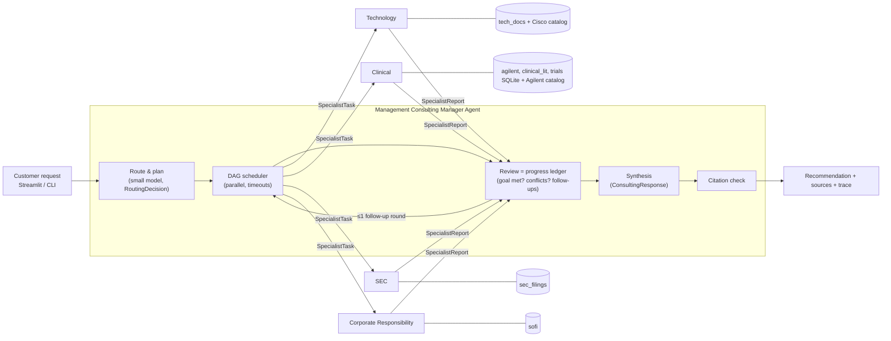

# Architecture

## 1. Components

| Layer | Code | What it does |
|---|---|---|
| Source manifest | `consultai/ingest/sources.py` | The only list of grounding documents (path, official URL, metadata, known gaps). |
| Ingestion | `consultai/ingest/{extract,build,trials}.py` | PDF pages (PyMuPDF), saved web pages (template-line removal), ClinicalTrials.gov CSV → SQLite. |
| Retrieval | `consultai/retrieval/` | Structure-aware chunks; BM25 + `bge-base-en-v1.5` dense, RRF fusion, `bge-reranker-base` cross-encoder; metadata filters. All local. |
| Catalogs | `scripts/extract_catalogs.py`, `agents/*/catalog.py` | Claude extracts Cisco platforms/parts and Agilent products; code keeps only items whose strings appear on the cited page. |
| Specialists | `consultai/agents/<name>/{prompt.md,agent.py}` | Persona prompt + domain tools + shared `read_page` and `submit_report`. |
| Claude access | `consultai/llm/claude_runner.py` | claude-agent-sdk with the local Claude Code login; built-in tools off, own MCP tools only, no user settings. |
| Manager | `consultai/orchestrator/` | Router, scheduler, ledgers, review, synthesis, citation validation, trace, rendering. |
| UI | `app/` | Streamlit: live consult, run history, agent cards, evaluation, market basket. |

## 2. Inter-agent contracts (`consultai/contracts.py`)

All hand-offs are Pydantic models, validated at every boundary and logged in full.

1. **RoutingDecision** (router → manager): intents, `assignments[{agent, relevance, rationale, sub_question,
   entities, expected_outputs, depends_on}]`, facts given / to look up (task ledger), out-of-scope parts,
   clarifying questions, `blocking`. Code enforces it: known agents only, relevance ≥ τ (0.5, from the routing
   sweep), no self/unknown dependencies, cycles broken.
2. **SpecialistTask** (manager → specialist), the *only* input a specialist sees: the verbatim customer request,
   its objective, entities, constraints, expected outputs, `upstream` (structured findings + cited evidence of the
   tasks it depends on), follow-up reason, tool budget.
3. **Evidence**: created by tool code, never by a model. Id with agent prefix (`TECH-3`, `CLIN-7`, `SEC-2`,
   `CSR-5`), source, page/section/NCT locator, official URL (with `#page=`), snippet, retrieval scores, query.
4. **SpecialistReport** (specialist → manager): status, answer summary, `findings[{claim, basis
   (confirmed | inferred | general_knowledge), evidence_ids, confidence, confidence_reason}]`, recommendations
   (with ranked items from recommender tools and KPIs), missing information, assumptions, risks, sources searched,
   plus the cited evidence objects (attached by code). Submitted through the `submit_report` tool whose input schema
   *is* the contract; the handler rejects unknown evidence ids, other agents' ids, `confirmed` claims without
   evidence and `high`-confidence general knowledge, and the agent must fix and resubmit.
5. **ReviewDecision** (manager): per-task answered/gaps/issues, cross-agent conflicts, `goal_met`, follow-ups.
6. **ConsultingResponse** (manager → customer): executive summary, answer, prioritized recommendations (owner
   agents, evidence, basis, confidence), cross-domain insights (≥2 agents), conflicts with resolutions, confirmed
   vs hypotheses (each attributed to an agent), questions for the customer, next steps, impact metrics (KPI,
   measurement, baseline source, target), risks, limitations. `citations.py` then resolves every id against the
   reports' evidence, strips unresolvable ones and records a `citation_check`.

## 3. Orchestration

- **Dynamic fan-out.** The router assigns as many specialists as the request genuinely spans (0-4). Requests no
  source covers (IBM, travel, personal medical advice) get no specialist and an explanation.
- **Dependencies.** `depends_on` turns the plan into a DAG. `run_dag` starts each task as soon as its upstream tasks
  finish; independent tasks run concurrently (semaphore = 4). Upstream results travel as structured
  `UpstreamContext`, not prose.
- **Failure containment.** Each specialist runs under a timeout with one retry on transport errors. Any exception or
  timeout becomes a `failed` report; other specialists continue; dependents are told their upstream failed; the
  synthesis lists the gap under limitations. If synthesis itself fails, the specialists' own summaries are returned,
  labelled as such. Demo: `python scripts/consult.py --scenario isr_refresh_vendor_risk --inject-failure sec`.
- **Evaluate-goal loop (slide 3).** After round 1 the manager reviews all reports (progress ledger). If the goal is
  not met and a specialist could close a gap or conflict from its own sources, it issues ≤3 follow-up tasks in one
  extra round (possibly to an agent not routed initially). Gaps only the customer can fill become questions.
- **Synthesis, not concatenation.** The synthesis prompt requires cross-domain insights that combine ≥2 agents,
  explicit conflict resolution, attribution of every claim, and carries forward each specialist's basis.
- **Multi-turn.** Earlier requests, our summaries and open questions are passed to the router and to each task.

## 4. Observability

Every step emits a trace event (`run_started`, `routing_decided`, `task_dispatched` with the full task,
`tool_called`/`tool_result` with arguments, evidence ids and scores, `report_received` with the full report,
`review_decision`, `synthesis_done`, `citation_check`, `error`, `run_finished`). Events are appended to
`runs/<run_id>/trace.jsonl` and streamed live to the UI/CLI; the complete `RunResult` (routing, ledgers, tasks,
reports, reviews, response, citation check, timings, token usage) is saved as `runs/<run_id>/run.json`. The UI's
run view draws the orchestration graph (who depended on whom, status, evidence counts) and shows every hand-off.

## 5. Grounding guarantees and their limits

- Agents have no web or file access; their only tools query the indexed course sources.
- Evidence ids are minted by tools, so a cited id always points to a real retrieved passage. Whether the passage
  *supports* the claim is checked by the LLM judge in the response-quality evaluation, not guaranteed by code.
- Catalog verification checks that each part number / value string appears on the cited page; it does not check
  that the value sits in the right table column (spot-checked manually for the Catalyst 8300 IPsec values).
- Trial counts come from SQL; financial ratios from the `calc` tool; neither is computed by the model.
